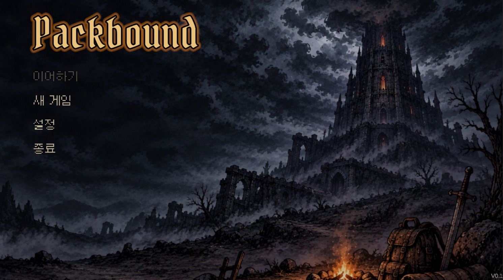
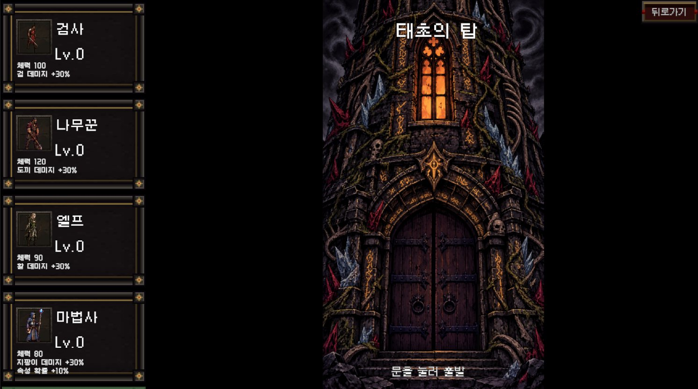
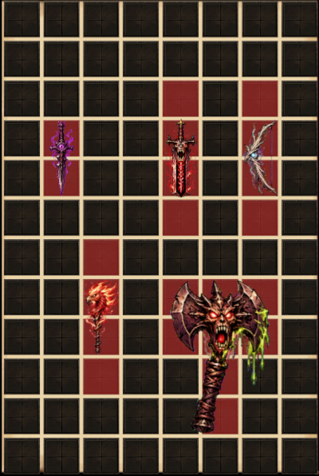
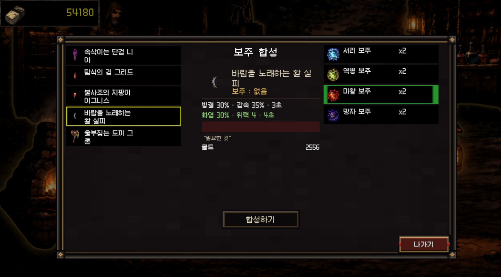
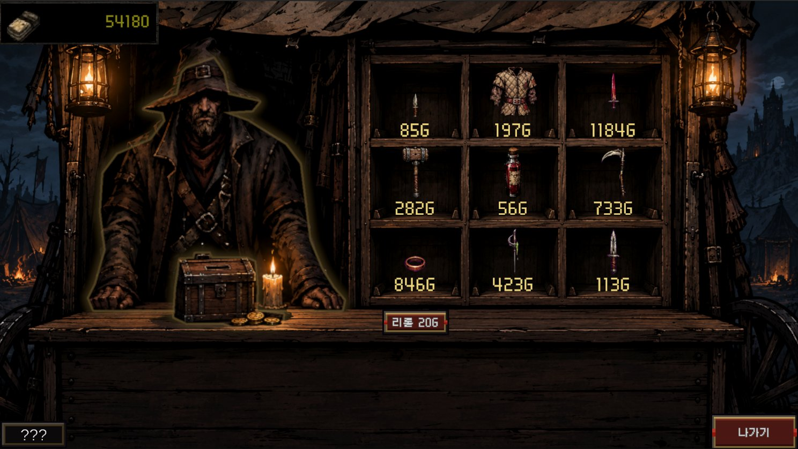
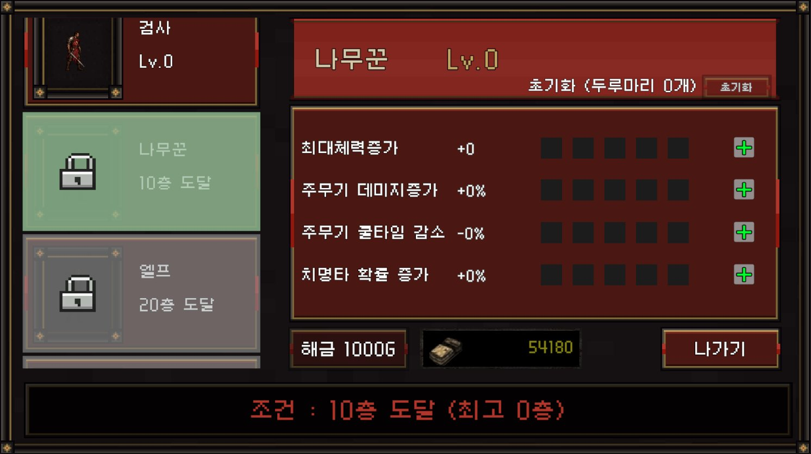
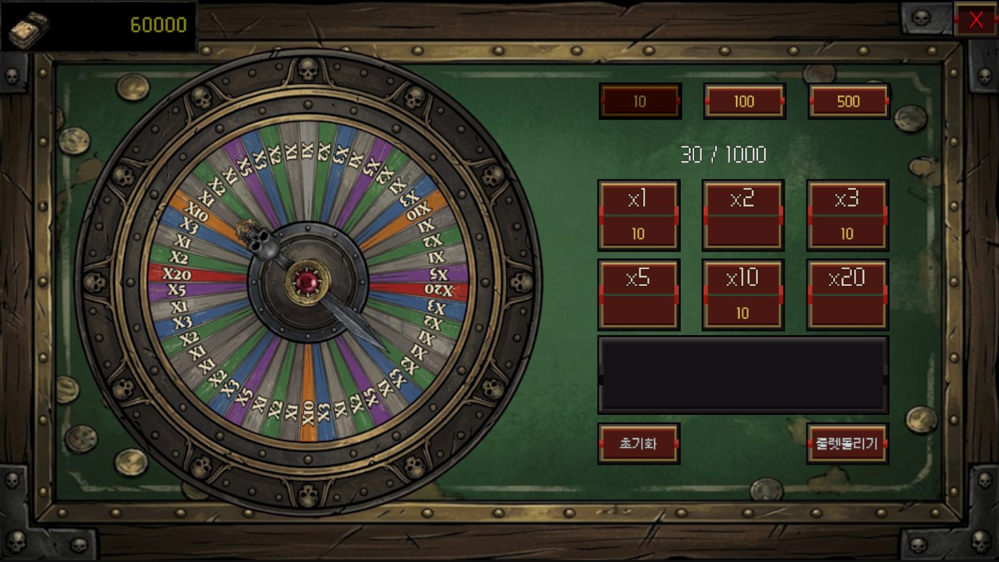

# Packbound

> 가방에 무엇을, 어떻게 넣느냐가 곧 전투력이 되는 **격자 인벤토리 × 자동 전투 로그라이크**
> 1인 개발 · Unity 6000.3.17f1 · STOVE 출시 준비 중



| 탑 선택 | 격자 인벤토리 | 보주 합성 |
|---|---|---|
|  |  |  |
| **상점** | **직업 훈련** | **룰렛** |
|  |  |  |

---

## 게임 소개

- 마을에서 장비를 사고, 강화하고, 가방에 배치한 뒤 탑에 오릅니다.
- 전투는 자동으로 진행됩니다. 가방 안 아이템들이 각자의 쿨타임마다 공격·회복·방어를 실행합니다.
- 5층마다 축복을 골라 매 판 다른 빌드로 성장합니다.
- 죽거나 클리어하면 마을로 돌아와 재료로 직업 훈련, 장비 강화(+10), 보주 합성을 진행합니다.

| 항목 | 내용 |
|---|---|
| 장르 | 로그라이크, 인벤토리 관리, 자동 전투 |
| 콘텐츠 | 직업 5종, 무기 40여 종, 축복 70여 종, 시련의 탑 / 원소 탑 4종(서리·역병·마왕·망자) / 태초의 탑 |
| 개발 | 1인 (기획·프로그래밍·데이터 밸런스) |
| 스크립트 | C# 약 260개 |

## 개발 환경

| | |
|---|---|
| 엔진 | Unity 6000.3.17f1 |
| 언어 / IDE | C# / Visual Studio 2022 |
| 데이터 | Google Sheets → CSV → 런타임 파싱 |
| 버전 관리 | Git / GitHub |

## 실행 방법

1. Unity Hub에서 **6000.3.17f1**로 프로젝트 폴더를 엽니다.
2. 타이틀 씬을 열고 Play 합니다.
3. 빌드: `File > Build Profiles > Windows` 에서 빌드합니다.

---

## 핵심 구현

### 1. 시트 기반 데이터 파이프라인

기획 데이터를 코드에서 분리해, **시트만 고치면 게임에 반영**되도록 만들었습니다.

```
Google Sheets ─(CSV)→ TextAsset ─→ CsvTable ─→ InfoParser ─→ DataManager
                                   열 이름으로 조회   행 → *Info 객체   등록 + 교차 검증
```

- **CsvTable**: 열을 *순서가 아니라 이름*으로 찾습니다. 시트에서 열을 옮겨도 코드가 깨지지 않습니다. 따옴표 안 쉼표, `""` 이스케이프를 처리하고 `#` 으로 시작하는 행은 메모로 보고 건너뜁니다(시트 안에 `# ── 서리의 탑 ──` 같은 구분 행 사용).
- **InfoParser**: 시트 종류마다 `TryParseXxx(row, errors, out info)` 하나씩. 실패해도 예외를 던지지 않고 **시트 이름과 실제 행 번호**를 담은 오류를 모읍니다.
- **DataManager**: 파싱 결과를 ID로 등록하면서 중복 ID, 존재하지 않는 아이템 참조, 튜토리얼 순서 중복 등을 검사하고 로딩 끝에 한 번에 경고로 출력합니다.

→ 기획을 수정할 때 "몇 번째 시트 몇 행이 틀렸다"를 바로 알 수 있어, 밸런스 수정을 코드 수정 없이 반복할 수 있었습니다.

### 2. 격자 인벤토리 (모델 / 뷰 분리)


- **GridContainer** (순수 C#): `Dictionary<Vector2Int, ItemInstance>` 로 칸 점유를 관리합니다. `CanPlace → TryPlace` 에서 범위, 겹침, 컨테이너별 수용 규칙(`Func<ItemInstance,bool>`)을 검사합니다. 회전 4방향 × 전체 칸을 훑는 자동 배치(`TryAutoPlace`)도 지원합니다.
- **ItemInstance / ItemShape**: 아이템은 모양(칸 목록)과 회전값을 가지고, `GetCellsAt(anchor, rotation)` 으로 차지하는 칸을 계산합니다.
- **View 계층** (`GridView`, `ItemView`, `DragController`, `ItemViewPool`): 모델의 `Changed` 이벤트만 구독해 다시 그립니다. 아이템이 차지하는 칸을 모양대로 표시하고, 드래그 중에는 놓을 수 있는지 검사합니다.
- 가방, 창고, 전리품 칸, 상점 판매 칸이 같은 `GridContainer` 를 재사용합니다.

### 3. 쿨타임 기반 자동 전투

- **ItemAction**: 아이템 하나 = 쿨타임 하나. `Tick(deltaTime)` 으로 타이머를 줄이고, 0이 되면 `IBattleEffect.Execute()` 를 호출합니다. 실행 직전 `windup` 시점에 이벤트를 보내 공격 애니메이션과 타이밍을 맞춥니다.
- **IBattleEffect**: 공격/회복/보호막을 각각 클래스로 분리하고 `BattleEffectFactory` 가 시트 데이터로 생성합니다. 새 효과는 클래스 하나만 추가하면 됩니다(OCP).
- **UnitHealth** (추상): 회피 → 보호막 → 피해 감소 → 사망 판정 순서를 템플릿으로 고정하고, `TryDodge`, `ReduceDamage`, `CanBeKilledBy`, `TryCheatDeath` 를 플레이어/몬스터가 재정의합니다.
- 상태이상(화염, 독, 빙결 감속)은 `IStatusEffect` + `StatusEffectFactory` 로 분리했습니다.

---

## 트러블슈팅

### 보스에게 한 방에 죽어 물약이 소용없던 문제
- **문제**: 체력이 가득해도 보스 강공 한 번에 죽어, 가방에 넣은 회복 물약이 쓰일 기회가 없었습니다.
- **원인**: 사망 판정이 피해 직후 바로 확정되고, 물약은 쿨타임에만 반응했습니다.
- **해결**:
  - `IDeathGuard` 인터페이스를 만들어 `UnitHealth` 가 사망 직전 등록된 가드에게 먼저 물어보게 했습니다. `PotionUser` 가 이를 구현해 물약이 있으면 그 자리에서 사용합니다.
  - `PlayerHealth.CanBeKilledBy` 를 재정의해 *체력 50% 이상에서 맞은 일반 공격*과 *독/화염 지속 피해*로는 체력이 1 아래로 내려가지 않게 했습니다.
- **결과**: 사망 규칙은 `UnitHealth` 를 고치지 않고 확장만으로 추가되었습니다.

### 클리어한 탑과 다른 탑이 무너지는 컷씬
- **문제**: 망자의 탑을 클리어했는데 컷씬에서는 마왕의 탑이 무너졌습니다.
- **원인**: 결과 화면에서 다음 탑으로 진행 상태를 먼저 바꾼 뒤 컷씬이 *현재 탑*을 읽었습니다.
- **해결**: 세션에 `LastRunTower` (이번 판에 오른 탑)를 따로 저장하고 컷씬과 결과 화면이 그 값을 읽게 했습니다.

### 데미지 숫자가 겹쳐 읽을 수 없던 문제
- **문제**: 여러 아이템이 같은 프레임에 터지면 숫자가 한 자리에 겹쳤습니다.
- **해결**: `DamageTextSpawner` 가 직전 생성 시각과 비교해 짧은 시간 안에 연달아 나오면 위로 한 칸씩 쌓고, 좌우로 약간 흔들어 배치합니다. 숫자 오브젝트는 풀링해 재사용합니다.

---

## 코드 위치

| 기능 | 경로 |
|---|---|
| CSV 파싱 | [`Assets/01.Scripts/DataInfo/CSV/`](Assets/01.Scripts/DataInfo/CSV) |
| 데이터 등록·검증 | [`Assets/01.Scripts/Managers/DataManager.cs`](Assets/01.Scripts/Managers/DataManager.cs) |
| 인벤토리 모델 | [`Assets/01.Scripts/Inventory/Model/`](Assets/01.Scripts/Inventory/Model) |
| 인벤토리 뷰 | [`Assets/01.Scripts/Inventory/View/`](Assets/01.Scripts/Inventory/View) |
| 전투 / 아이템 효과 | [`Assets/01.Scripts/Battle/`](Assets/01.Scripts/Battle) |
| 체력·사망 규칙 | [`Assets/01.Scripts/Unit/`](Assets/01.Scripts/Unit) |
| 강화·보주 | [`Assets/01.Scripts/Forge/`](Assets/01.Scripts/Forge) |
| 세이브 | [`Assets/01.Scripts/Save/`](Assets/01.Scripts/Save) |

## 문서

- 기획서: [Google Docs](https://docs.google.com/document/d/12tGsvByGUF_2JuboiRz6Fwzi4JEHE6ofoDNqc-1halg/edit?tab=t.0#heading=h.7rzftzer0l69)
- 데이터 시트: [Google Sheets](https://docs.google.com/spreadsheets/d/1sqJFNVGnjuZqKO7dilSKKd0Tg7Cq3JAyvnHGSr_QG1U/edit?gid=261861254#gid=261861254)

## 외부 리소스

- DOTween (Demigiant)
- 폰트: Galmuri9, Pirata One (SIL Open Font License)
- 일러스트·스프라이트 일부: AI 이미지 생성 도구로 제작 후 편집
- 효과음·BGM: 무료 사운드 리소스
